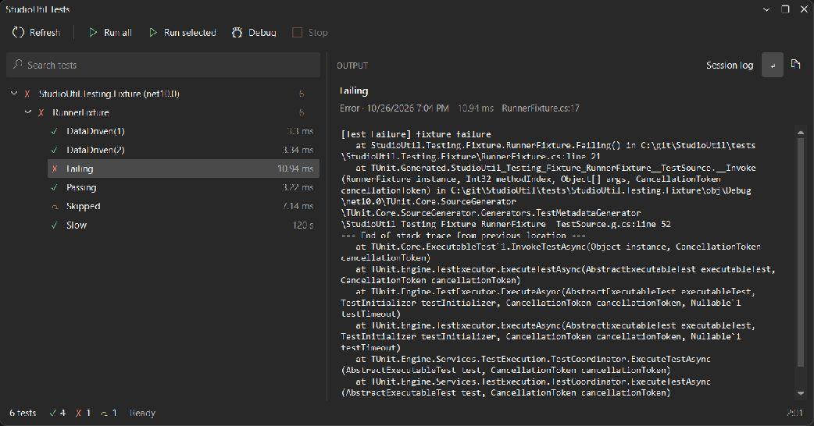
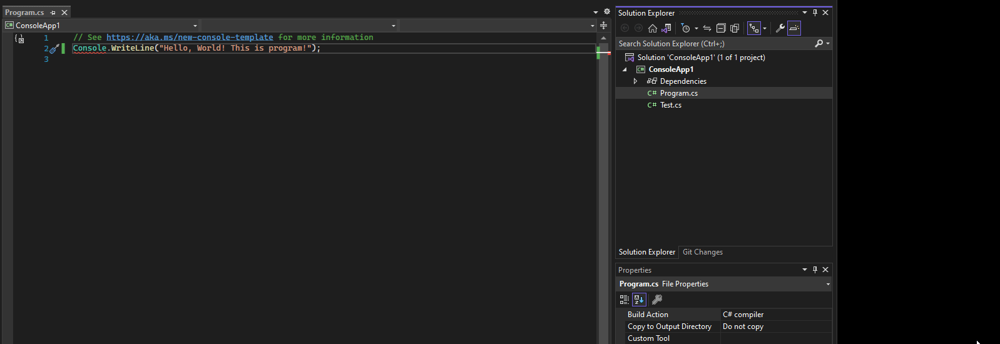
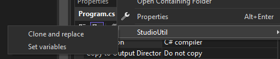
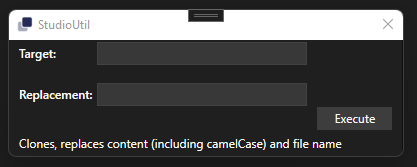

#  StudioUtil

StudioUtil adds a TUnit/Microsoft Testing Platform test runner and everyday file tools to Visual Studio. Run or debug tests directly from the editor, browse results and logs in a dockable window, and create files without repetitive copying and renaming.

## Test runner

Open **Tools → StudioUtil Tests**, or click the gutter marker beside a C# `[Test]` method and choose **Run** or **Debug**.

The runner keeps tests and output together in two resizable panes:

- **Tests on the left:** a searchable tree grouped by test module and class, with individual test cases, status indicators, counts, and durations.
- **Logs on the right:** output for the selected test, or a session log containing build output and runner diagnostics. Copy output, wrap long lines, and jump back to the test's source.

### Run and debug

1. Open a solution containing TUnit/MTP test projects.
2. Open **StudioUtil Tests**. If no cached tests are available, discovery starts automatically. Use **Refresh** to rebuild and discover changes.
3. Choose **Run all**, or select a test or group and use **Run selected** or **Debug**.
4. Select a test to inspect its output. Use **Session log** for restore, build, discovery, and execution diagnostics.

Starting from a gutter marker builds and discovers that project, then runs the runtime test cases associated with the source method, including its discovered parameterized cases. Debugging attaches Visual Studio to the test host before execution continues, so you can use normal breakpoints and stepping.

Right-click a test or group in the tree for **Run** and **Debug** actions. The menu acts on the row you right-click; keyboard users can open it with **Shift+F10** on the selected row.

Source locations in exception stack traces and compiler diagnostics appear as links in test output and the session log. Click a link to open the file at the reported line (and column when available). Output remains selectable and supports copying and line wrapping; source files must be available on your machine.

**Stop** cancels discovery or execution. Double-click a test, or use its source link in the output pane, to navigate to its code. The window and gutter menu use Visual Studio theme resources for light and dark themes.

### Previous results stay available

StudioUtil saves a local snapshot for each solution, including its test tree, latest results, durations, test output, session log, and selected test. Reopening the runner restores that snapshot so you can inspect previous results without waiting for a build.

Refreshing keeps the existing tree visible while projects build. Successful rediscovery updates the tree and retains results for matching tests; tests removed from a successfully rediscovered project are removed from the tree.

The cache holds the latest session snapshot, rather than an archive of every run. Logs are size-limited. Cache files are stored under `%LOCALAPPDATA%\StudioUtil\TestSessions` and are keyed by the solution path.

### Supported test projects

The runner targets **TUnit and Microsoft Testing Platform (MTP)**. Projects must evaluate `IsTestingPlatformApplication` to `true` and produce a runnable test application with MTP server-mode support. StudioUtil restores projects before evaluating those properties, including properties supplied by imported package targets.

Discovery builds projects in **Debug** configuration. Multi-targeted projects are evaluated and built per target framework. The editor markers currently recognize C# methods with `[Test]` or `[TestAttribute]`; runtime discovery supplies the executable test cases and their results.

This is not a VSTest adapter runner. Source-based Run/Debug also depends on the test host reporting source locations that map to the selected method.

## File and editor tools

Right-click a file, folder, or project in Solution Explorer and open the **StudioUtil** submenu.

### Clone and replace

Create a renamed copy of a file and replace matching text in its contents:

Choose **Clone and replace** to open the replacement dialog:

Enter the **target** text and its **replacement**.

For example, cloning `CustomerService.cs` with `Customer` → `Supplier` creates `SupplierService.cs` beside the original. Content replacement handles both the exact text and its camel-case form, such as `customer` → `supplier`, while preserving line endings. The source file remains unchanged.

### Paste files with replace

Copy files to the clipboard, select a destination, and choose **Paste files with replace**. StudioUtil copies the files into that directory while applying the same filename and content replacements, then adds the resulting files to the project.

### New files from clipboard

Copy C# declarations and choose **New files from clipboard** to create a file for each top-level type declaration, including classes, structs, interfaces, records, enums, and delegates.

Roslyn-based parsing keeps nested types inside their containing type and preserves explicit namespaces and using directives. For declarations without a namespace, StudioUtil derives one from the selected project's root namespace and destination folder. It also attempts to infer missing using directives.

### Download file

Choose **Download file** to download an HTTP or HTTPS resource into the selected directory and add it to the project. A URL in the clipboard prefills the dialog. StudioUtil uses the response's suggested filename when available, falling back to the URL filename.

### Set variables

Use **Set variables** to reuse target and replacement values during repeated cloning and pasting.

### Insert inheritdoc

Use **Insert inheritdoc** in the editor context menu, or press **Alt+Insert**, to insert an XML documentation inheritance tag. The command uses a recognized interface name from the following declaration when available. The edit participates in Visual Studio's undo history.

## Installation and requirements

Download StudioUtil from the [Visual Studio Marketplace](https://marketplace.visualstudio.com/items?itemName=soenneker.StudioUtil), or search for **StudioUtil** under **Extensions → Manage Extensions**.

This README describes the current source tree; the published Marketplace release may lag behind it. To try the current implementation, build the VSIX from source.

The current source version requires:

- Windows and x64 Visual Studio 17.x or 18.x (Community, Professional, or Enterprise).
- A .NET 11 runtime available through `dotnet` on `PATH` for the worker. A .NET 11 SDK installation also supplies the runtime.
- The SDKs and runtimes required by the solutions you want to build and test. The worker's .NET version does not require your test projects to target .NET 11.

## How it works

StudioUtil keeps Visual Studio-specific work in a .NET Framework 4.8 extension: menus, dialogs, clipboard access, the editor gutter, the test window, project integration, and debugger attachment.

A separate **.NET 11 worker process** handles test builds, discovery and execution, source parsing, session persistence, file transformations, code generation, and downloads. It uses Soenneker libraries for process execution, JSON, hashing, and file operations, including atomic writes for generated and downloaded files.

The extension and worker communicate over a versioned JSON protocol through standard input and output. Shared models live in `StudioUtil.Contracts` and appear as linked files under `Contracts` in both projects, keeping the protocol types consistent across the two runtimes.

StudioUtil is a work in progress. Contributions are welcome.
